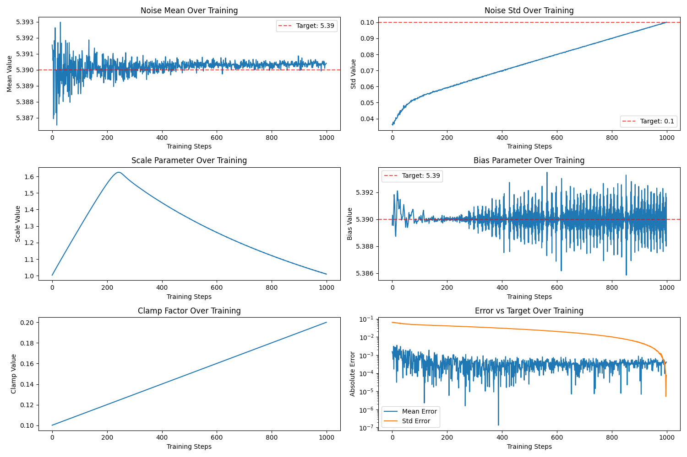

# ZPEDeepNet: adaptive noise generator

A small PyTorch experiment: a noise generator with a learnable scale and bias, trained so that its output hits a target mean and standard deviation. Its base amplitude comes from the zero-point energy formula E0 = ½ħω (with ħ = ω = 1 by default), which is where the name comes from.

## How it works

`AdaptiveZPENoise` in `zpe_noise.py` draws Gaussian noise for a 512-element vector, then:

1. scales it by E0, a clamp factor and a learnable per-element scale;
2. adds a learnable per-element bias;
3. clamps the result to a window around the target mean that widens as training goes on.

Adam trains the scale and bias on a weighted loss: the mean error, the standard-deviation error, and terms that keep the bias and scale near their targets. Every 100 steps the script checks both errors and stops once they are under 0.001. It also stops early when the error stops improving, or after 1,500 steps.

## Results

In a CPU run, the generator met both targets at step 1,000:

| | Target | Result |
|---|---|---|
| Mean | 5.39 | 5.3902 |
| Standard deviation | 0.1 | 0.0999 |

Over 10 further draws, the average mean was 5.3904 and the average standard deviation 0.1000. There is no fixed seed, so your numbers will differ slightly.



## Run

```bash
pip install -r requirements.txt
python zpe_noise.py
```

The script prints its progress and saves three plots to `plots/`. It runs on a GPU if one is available, otherwise on the CPU.

## License

MIT
